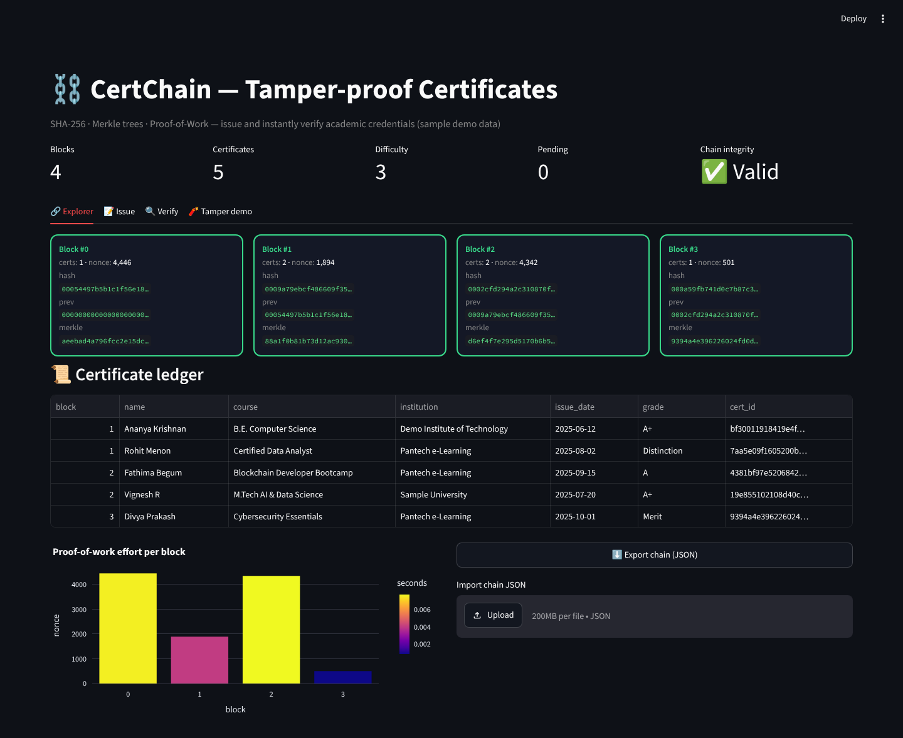
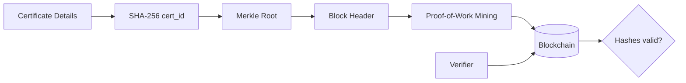
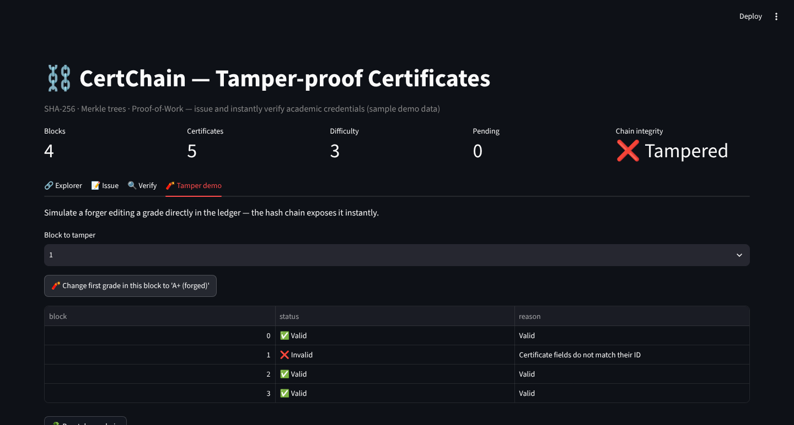

<div align="center">

# ⛓️ CertChain — Blockchain Certificate Verification

**Issue academic certificates on a proof-of-work blockchain and verify them instantly — any tampering is exposed.**

    

`Blockchain · Cryptography`

</div>

---



## 📌 Problem Statement

Fake degree certificates are a growing problem for employers and universities. Manual verification is slow and email-based.

## ✨ Key Features

- Blockchain built **from scratch**: SHA-256, Merkle root, proof-of-work mining with adjustable difficulty
- **Issue** certificates → deterministic certificate ID (hash of canonical JSON)
- **Verify** by certificate ID or by re-entering details
- **Tamper demo**: edit a grade and watch the integrity check fail
- Block explorer cards, certificate ledger and PoW effort chart
- Export / import the chain as JSON

## 🏗️ Architecture



## ⚙️ How It Works

1. Each certificate is hashed into a `cert_id`; a block stores certificates plus their **Merkle root**.
2. Mining increments a nonce until the block hash starts with *difficulty* zeros.
3. Every block stores the previous block's hash — changing any byte breaks the Merkle root, the block hash and all following links.
4. Validation re-computes all hashes and reports the exact block and reason for failure.

## 🖼️ More Screenshots

### Tamper detection


## 🧰 Tech Stack

| Layer | Tools |
|---|---|
| Language | Python 3.10+ |
| ML / Logic | pandas |
| UI & Visualisation | Streamlit, Plotly |

## 📁 Project Structure

```
BLOCKCHAIN-CERTIFICATE-VERIFICATION/
├── app.py             # Streamlit UI — explorer, issue, verify, tamper demo
├── blockchain.py      # Block, Blockchain, Merkle tree, PoW, validation, JSON persistence
├── assets/              # screenshots
├── requirements.txt
└── README.md
```

## 🚀 Getting Started

```bash
git clone https://github.com/PreciousBharath/BLOCKCHAIN-CERTIFICATE-VERIFICATION.git
cd BLOCKCHAIN-CERTIFICATE-VERIFICATION
python -m venv venv && source venv/bin/activate   # Windows: venv\Scripts\activate
pip install -r requirements.txt
streamlit run app.py
```

Open **http://localhost:8501** in your browser.

> The project ships with a realistic built-in demo dataset, so it runs out of the box with no downloads or API keys.

## 🗺️ Roadmap

- [ ] Deploy as an Ethereum / Polygon smart contract
- [ ] QR code on certificates for mobile verification
- [ ] Digital signatures (ECDSA) for issuers

## 👨‍💻 Author

**Bharath** — Software Developer · Project Engineer · Technical Trainer

[](https://linkedin.com/in/connectbharath)
[](https://itsbharathportfolio.netlify.app)
[](https://github.com/PreciousBharath)

⭐ If this project helped you, please give it a star!

## 📄 License

Released under the [MIT License](LICENSE).
